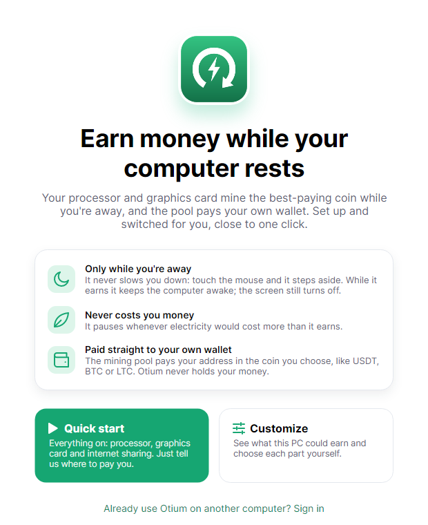
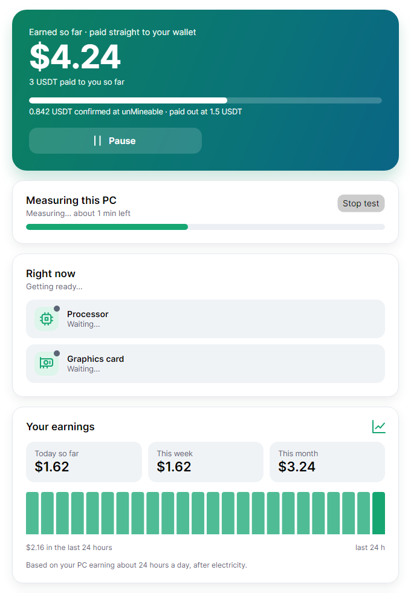

# Otium

*Latin for "idle time".* Otium earns money with your computer while you're away from it. Your processor and graphics
card mine the best-paying coin, and the mining pool pays **your own wallet**, in the coin you choose. Otium sets it all
up, switches coins for you and steps aside the moment you touch the mouse.

**[Download at otium.lol](https://otium.lol)** · Windows · macOS and Linux (beta)

<table>
  <tr>
    <td width="50%">
      <picture>
        <source media="(prefers-color-scheme: dark)" srcset="docs/screens/welcome-dark.png">
        
      </picture>
    </td>
    <td width="50%">
      <picture>
        <source media="(prefers-color-scheme: dark)" srcset="docs/screens/home-dark.png">
        
      </picture>
    </td>
  </tr>
</table>

<sub>Drawn from the app in dev mode, with a simulated Ryzen 7 7700X and RTX 4090. Your own numbers come from the
two-minute test on your PC.</sub>

## How it works

1. **Install and pick Quick start** (processor and graphics card on, internet sharing one tick away) or **Customize**
   (see what this PC could earn and choose each part).
2. **Paste one wallet address.** USDT on TRON is the default; BTC, LTC, ETH, BNB, SOL, TRX and Monero work too. The app
   checks the address and its network as you type. That address is the only place money goes.
3. **Press Start earning.** A two-minute test measures what this PC really earns, after fees and electricity. From
   then on Otium earns only while you're away (after 3 minutes without keyboard or mouse) and stops the moment you
   come back.
4. **The pool pays you.** [unMineable](https://unmineable.com) pays your address once a day after you reach its minimum
   (for example 1.5 USDT). The app shows how far you are from the next payout. US citizens and residents (the app asks)
   are paid in Monero by [MoneroOcean](https://moneroocean.stream), because unMineable doesn't serve them.

Otium never holds your money. There's no balance to cash out and no account you have to trust with funds.

Otium doesn't run in countries under international sanctions or where crypto mining is banned (for example Russia,
Iran, China and Egypt).

## What you get

- **Watches the price of power.** Otium pauses when electricity would likely cost more than it earns. The price is
  estimated for your country (or enter your own), or follows live hourly prices in Norway, Sweden, Denmark and
  Finland. Grid fees and taxes may not be included, so treat it as an estimate.
- **Steps aside for you.** Mining runs only while you're away and stops within a second when you're back (if you let
  it mine while you work, it runs at the lowest priority). It keeps the computer awake
  while it earns (the screen still turns off), never keeps a laptop on battery awake, and makes the computer warmer
  and its fans louder.
- **The best coin for your card.** The graphics card tests the coins it can mine, mines whichever pays most for it
  right now, and moves on if the pool stops crediting one. A coin that fails its test is tried again later.
- **Internet sharing (optional).** Earn from internet you're not using through [Proxybase](https://proxybase.xyz),
  paid to the same wallet in the same coin. It's off until you tick it, and the app explains who uses it first. Until
  your own numbers come in, the app and otium.lol estimate it from Proxybase's rate where you live (about $62 a month
  in Norway, for 1 GB a day); then the app shows what it really earns.
- **Plain reports.** "While you were away: $0.84 in 7 h 40 min", a monthly summary, and notifications for payouts and
  problems. Each can be shared as a picture with your invite code.
- **Options in Settings:** efficiency mode for NVIDIA cards (70% power while mining), let the graphics card earn while
  you browse (stops for games and full-screen video), and keep the miner ready so it starts again instantly.
- **Invites.** Friends you invite mine fee-free for 30 days, and part of Otium's fee is mined to you for 6 months.

## What it costs

| Who | Takes |
|---|---|
| Otium | 2% of mining time (about 29 minutes per day of mining), mined to Otium's address. Nothing while paused. |
| Mining software | XMRig 1% (processor), SRBMiner 0.85–2% (graphics card, depending on the coin) |
| Pool | unMineable 0.75% (1% without Otium's referral code; unMineable pays Otium part of its own fee for the code) |
| Internet sharing | 2% of sharing earnings, paid to Otium's address before the rest is converted to your coin (the conversion itself has no Otium fee) |

In total about 3.75% on the processor and 3.6–4.75% on the graphics card. The app shows the same breakdown before you
start.

## Safety and privacy

- Otium runs well-known miners, [XMRig](https://github.com/xmrig/xmrig) (open source) and
  [SRBMiner-Multi](https://github.com/doktor83/SRBMiner-Multi), downloaded from their official releases and checked
  against fixed SHA-256 hashes. Some antivirus tools flag any miner; the app tells you if yours blocks it and how to
  allow it.
- Otium's server keeps your payout address, your computers and invite codes. An email address is optional (it lets
  you keep your invites when you reinstall). Settings has **Download my data** and **Delete my account**.
- "Share analytics" is a yes-or-no question at the start (and a switch in Settings). If you say yes, the app sends your
  graphics card and processor model and what they earned (and, if you share your internet, your country and what
  sharing earned), never your address. otium.lol shows only figures combined across several PCs. Saying no later
  deletes what was sent.
- Uninstalling removes the miners, Otium's scheduled tasks and its downloaded files.

## Help

Something not working? In the app, go to **Settings → Send a problem report**. It sends what each miner is doing and
their recent messages, with your addresses and keys taken out, and gives you a reference. Then
[open an issue](https://github.com/Malogna/otium/issues) and mention it.

## For developers

```bash
dotnet test                              # unit and API tests
pwsh build/dev.ps1                       # dev mode: app, server and a simulated pool on one PC
dotnet run --project src/Otium.App       # the app on its own
```

The app is .NET 10 with Avalonia, and the server is ASP.NET Core with SQLite. How everything works, the server's
settings, building installers and releasing are in [docs/technical.md](docs/technical.md). Also:
[deploying](docs/deploying.md), [releasing](docs/releasing.md), [release candidates](docs/release-candidate.md),
[privacy policy draft](docs/privacy.md), [terms of use draft](docs/terms.md).

## License

Otium is free software under the [GNU Affero General Public License v3.0](LICENSE). You may use, study, change and
share it. If you distribute a changed version, or run a changed version of the server for other people, you must
publish your changes under the same license.

XMRig, SRBMiner-Multi and Proxybase's client are separate programs under their own licenses. They aren't part of this
repository: the app downloads them from their official releases on each computer.

## Trademarks

The license covers the code, not the name. Forks are welcome, but please don't call them Otium, use Otium's logo, or
present them as the official app or otium.lol.
