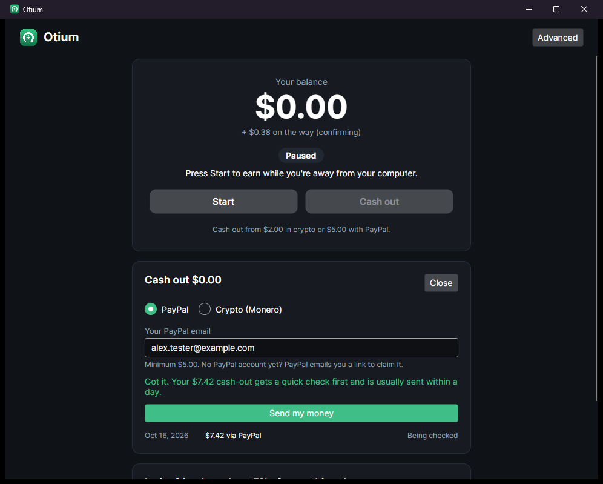

# Otium

*Latin for "idle time".* Otium is a one-click desktop app for Windows, macOS and Linux that earns money from a computer's spare power while nobody is using it. People cash out with PayPal or crypto.

| First launch | Home | Cash out | Advanced |
|---|---|---|---|
|  |  |  |  |

## For users: one button

1. Install and open Otium.
2. Press **Start earning**. No wallet and no settings are needed.
3. Otium starts when you sign in and earns only while you're away from the computer, after 3 minutes without keyboard or mouse input. It pauses the moment you come back, and also when electricity would cost more than it earns (the price is estimated from your country).
4. Your balance grows in dollars. Press **Cash out** to get paid by PayPal or crypto (Monero).
5. Share your invite code. Friends mine fee-free for 30 days, and you get 5% of everything they earn.

Everything technical lives under **Advanced**:
- Details per device, including GPU algorithm and speed, power draw, and profit per day.
- CPU usage, the idle delay, your electricity price, and switching devices on or off.
- Getting paid by the pool straight to your own Monero wallet instead of an Otium balance.
- Updates.

## How it works

```
 desktop app (Avalonia, .NET 10)                         Otium server (ASP.NET Core + SQLite)
 ┌──────────────────────────────┐   register / balance   ┌─────────────────────────────────────┐
 │ CPU: XMRig (RandomX)         │ ─────────────────────▶ │ accounts, worker ids, pool addresses │
 │ GPU: SRBMiner, best algorithm│ ◀───────────────────── │ ledger (USD), referrals              │
 │ idle detection, power meter  │   cash-out requests    │ earnings creditor  (every 10 min)    │
 └──────────────┬───────────────┘                        │ cash-out processor (every minute)    │
                │ hashes, worker = account id            └───────┬──────────────────┬───────────┘
                ▼                                                │ pool stats       │ payouts
        MoneroOcean pool  ── pays XMR ──▶ operator wallet ◀──────┘                  ▼
                                                              PayPal Payouts API / monero-wallet-rpc
```

**Mining**
- The CPU runs XMRig. The GPU runs SRBMiner on whichever algorithm pays most after fees and measured electricity (kawpow, autolykos2, etchash, cn/gpu or pearlhash). MoneroOcean converts everything to XMR.
- Each account mines under its own worker id to one of the operator's pool addresses.

**Crediting** (`src/Otium.Server/Earnings`)
- Every 10 minutes the server reads MoneroOcean's per-worker hashrate history. It uses `hs2`, the XMR-equivalent hashrate, so CPU and every GPU algorithm are valued on one scale.
- It credits the expected value: hashes × block reward ÷ difficulty × XMR price.
- Credits are reduced by the fee (10% by default; 0% during a referral fee-free period).
- Credits are held 48 hours before they can be cashed out.
- Referrers get 5% of a friend's gross earnings, paid out of the fee.
- The operator carries the pool's luck. `GET /admin/summary` compares what was credited against what the pool actually paid.

**Pool addresses**
- MoneroOcean reports only about 50 simultaneously active workers per address separately; beyond that, everything is lumped together.
- The server therefore spreads accounts across subaddresses of the operator's wallet, 40 per address, creating new ones through `monero-wallet-rpc` when needed. All payouts still land in one wallet.

**Cash-outs** (`src/Otium.Server/Payouts`)
- The whole available balance is debited in one database transaction.
- **Sent automatically:**
  - Crypto through `monero-wallet-rpc`: up to 15 cash-outs share one transaction, and Otium pays the network fee.
  - PayPal through the PayPal Payouts API: one batch per cash-out, using the cash-out id as `sender_batch_id` so a retry can never pay twice.
- **Held for review:**
  - accounts younger than 2 days;
  - amounts over $50;
  - a destination already used by another account;
  - the daily automatic payout budget being used up;
  - a yearly total near the US tax-reporting threshold ($2,000; tax details are needed);
  - the method's provider not being set up yet.
- Failed or returned payouts go back to the balance.

**Own-wallet mode** (Advanced) works as before: the pool pays the user's own XMR wallet directly, a 2% fee is mined in short time slices, and referral rewards are mined to the referrer's wallet.

## Running the server

Configure `src/Otium.Server/appsettings.json` (or environment variables such as `Earnings__PoolWallets__0=...`):

| Setting | Purpose |
|---|---|
| `ConnectionStrings:Otium` | SQLite database path |
| `Earnings:PoolWallets` | Operator XMR addresses (subaddresses of one wallet). Balance mode is off until at least one is set or the wallet RPC is configured. |
| `Earnings:FeePercent`, `ReferralPercent`, `HoldPeriod` | Business terms; defaults 10%, 5%, 48 h |
| `Cashouts:*` | Minimums ($5 PayPal, $2 crypto), automatic-approval limit, daily budget, minimum account age |
| `PayPal:ClientId`, `ClientSecret`, `UseSandbox` | PayPal Payouts. Use the sandbox until PayPal approves the live account. |
| `MoneroWallet:RpcUrl`, `Username`, `Password` | `monero-wallet-rpc` with `--rpc-login`, on localhost or a private network |
| `Admin:Token` | Enables `/admin/*`; send it as `X-Admin-Token` |
| `Referral:PublicBaseUrl`, `DownloadUrl` | Invite links and the landing page |

Run it locally:

```bash
dotnet run --project src/Otium.Server
```

Operator endpoints:

| Endpoint | Purpose |
|---|---|
| `GET /admin/summary` | Credited vs. pool-earned totals, money owed to users, pool address load |
| `GET /admin/cashouts?status=review` | The review queue |
| `POST /admin/cashouts/{id}/approve` | Release a reviewed cash-out for automatic sending |
| `POST /admin/cashouts/{id}/reject` | Reject it; the amount goes back to the balance (`{"note": "..."}`) |
| `POST /admin/cashouts/{id}/mark-paid` | Record a payout you made by hand (`{"note": "PayPal txn ..."}`) |

The app finds the server through `AppIdentity.DefaultServerUrl`, which is overridable with `OTIUM_SERVER_URL`.

## Building the desktop app

You need the .NET 10 SDK. On this machine it's installed per-user, so add it to `PATH` for the session first:

```powershell
$env:PATH = "$env:LOCALAPPDATA\Microsoft\dotnet;$env:PATH"
```

Run the tests (109, covering crediting, cash-outs, fraud rules, GPU profit switching, wallet checksums and the engine):

```bash
dotnet test
```

Run the app. `OTIUM_HOME` keeps your real data folder untouched:

```bash
dotnet run --project src/Otium.App
```

Build installers. Output goes to `artifacts/releases/<runtime>/`:

```bash
pwsh build/package.ps1
```

| Platform | Package | Notes |
|---|---|---|
| Windows x64 | `Otium.Desktop-win-x64-Setup.exe` + portable zip | Per-user install to `%LocalAppData%\Otium.Desktop`; data stays in `%LocalAppData%\Otium` |
| Linux x64 | `Otium.Desktop-linux-x64.AppImage` | Needs the standard X11 session libraries (`libice6 libsm6`) |
| macOS arm64 / x64 | `.pkg` + zip | Built on macOS only (CI) |

**Releasing:** push a tag such as `v0.2.0`. `.github/workflows/release.yml` tests, builds every platform and publishes one GitHub release. To turn on auto-updates for installed copies, set `AppIdentity.UpdateUrl` to the repository URL.

## Project layout

```
src/Otium.Core               engine, provider interface, fees, power, GPU detection (NVML), profit switcher,
                             wallet checksums, account contracts and client
src/Otium.Providers.XMRig    CPU miner provider
src/Otium.Providers.SrbMiner GPU miner provider with benchmarking and profit switching
src/Otium.App                desktop app (Welcome → Home ⇄ Advanced), Velopack updates
src/Otium.Server             accounts, crediting, cash-outs, referrals, landing page, admin API
tests/Otium.Tests            unit and API tests
build/                       packaging script, icon generator, icons
```

## Before launch

- **Legal review (required).**
  - In balance mode the operator holds users' earnings and pays them out.
  - US: FinCEN treats pool payouts as non-transmission, but hosting balances for members can make the operator a money transmitter.
  - EU: MiCA may apply to holding or transferring crypto for users.
  - The design keeps balances in USD for compute bought from users and never offers a withdrawable crypto balance, but this needs counsel to confirm.
  - Collect tax details (W-9/W-8) before anyone passes the yearly reporting threshold.
- **PayPal approval.** Payouts must be enabled on a business account, and PayPal pre-approves crypto-related businesses. Describe the mining revenue source honestly. Until approved, PayPal cash-outs land in the review queue for manual payment.
- **Deploy the server** behind HTTPS with backups of the SQLite database. Set `AppIdentity.DefaultServerUrl`.
- **Fund the hot wallet** in `monero-wallet-rpc` and keep only what payouts need in it.
- **Code signing** for Windows and macOS: add the certificates as the CI secrets listed in the workflow.
- **Real-machine run:** do a real mining run on your RTX 3080 to confirm SRBMiner's stats format and the GPU speed units.
