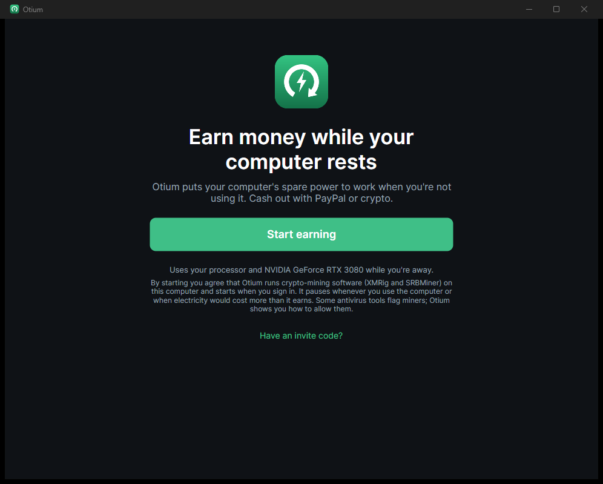
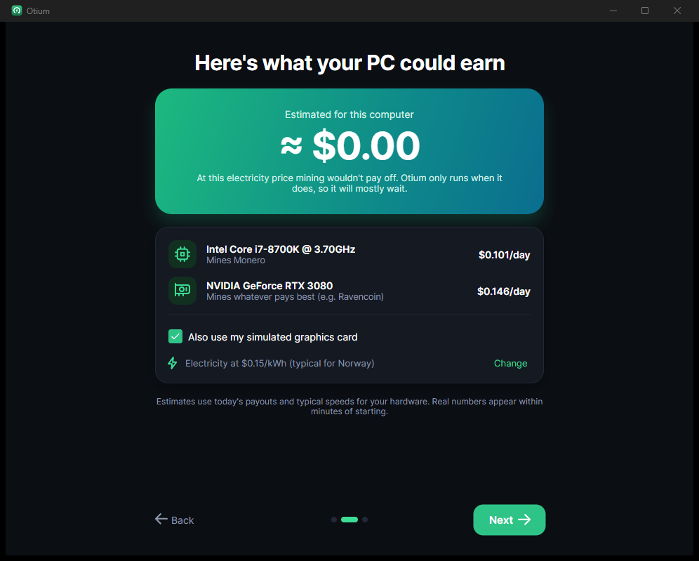
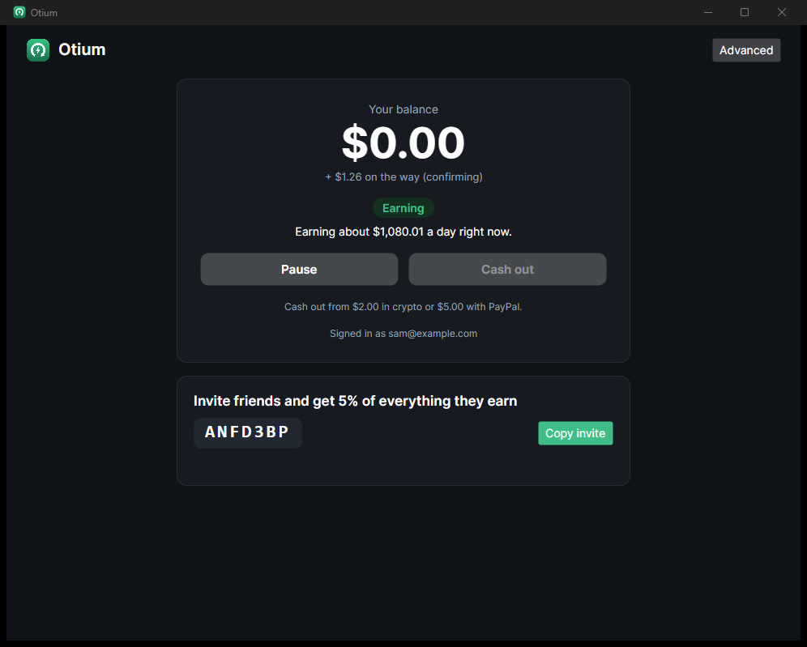
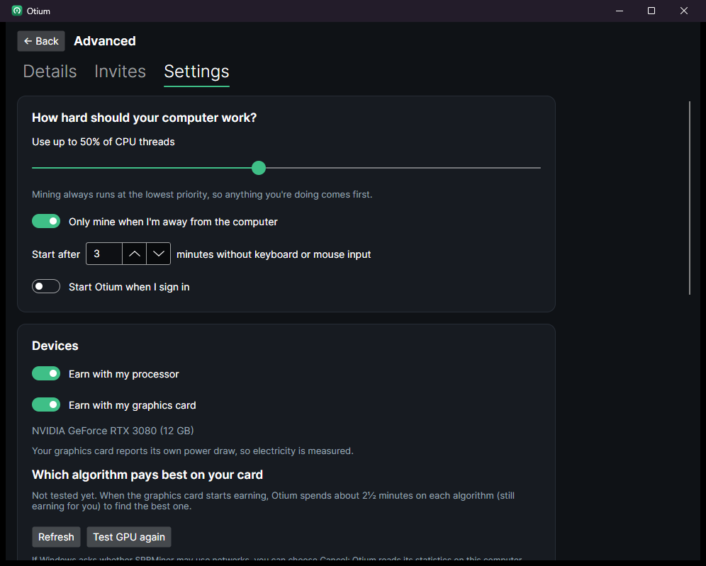

# Otium

*Latin for "idle time".* Otium is a desktop app for Windows, macOS and Linux that brings the different ways a computer can earn
while nobody is using it (processor and graphics card mining, and more to come) into one place, set up and switched
automatically, as close to one click as possible. It's for people with some tech knowledge: the pools pay each user
directly to their own wallet, in the coin they choose (USDT on TRON, BTC, LTC, BNB, SOL, TRX, ETH or Monero). Otium
never holds anyone's money.

| First launch | What this PC could earn | Overview | Advanced |
|---|---|---|---|
|  |  |  |  |

<sub>Dev mode at real-world speed: simulated i7-8700K and RTX 3080 with electricity at $0.15/kWh, where mining doesn't pay. Otium says so plainly instead of promising money.</sub>

## For users: one button

1. Install and open Otium. Four short screens explain it, show what this computer could earn per month (from its
   processor and graphics card, today's payouts and your electricity price), ask where to pay you, and summarise what
   will happen.
2. **Where should we pay you?** Pick a coin (USDT on TRON by default) and paste your own address for it. It's checked as
   you type, including the network, and the screen says which network to pick in your wallet and when the pool pays
   (unMineable: daily once you reach its minimum, e.g. 1.5 USDT). US users are paid in Monero by MoneroOcean, because
   unMineable doesn't serve US residents.
3. Press **Start earning**. Right away, a two-minute test runs the miners while you watch and measures what this PC
   really earns (on its best coin, after Otium's fee and electricity), so the overview shows your own numbers instead
   of a hardware table's; it earns for real, to your address, and can be run again from the overview. From then on Otium starts when you sign in and earns only while you're away from the computer, after 3 minutes without keyboard or mouse input. While it earns on mains power it keeps the computer awake, so Windows' usual sleep timer doesn't stop it for the night; the screen still turns off, and laptops on battery are left alone (Settings can turn this off). It pauses the moment you come back, and also when electricity would cost more than it earns (the price is estimated from your country; in Norway, Sweden, Denmark and Finland it follows live hourly spot prices, from hvakosterstrommen.no, elprisetjustnu.se, elprisenligenu.dk and sahkotin.fi).
4. The pool pays your address by itself. The overview shows how far you are from its next payout ("0.84 USDT at
   unMineable · paid out at 1.5 USDT", with an estimate of when) and warns you if the pool won't pay on its own, for
   example when unMineable's "Auto pay" switch is off for your address (new TRC-20 addresses start with it off), with a
   link to your address page there.
5. Share your invite code. Friends mine fee-free for 30 days, and part of Otium's fee is mined for you. The Invites page
   has ready-made messages (short, explained, for gamers) that you can edit, one-click sharing to WhatsApp, Discord and
   email, and a monthly leaderboard of top inviters, counted by friends who actually started earning.
6. Optionally, earn from your internet connection too: the overview suggests it once, explains in plain words what
   sharing unused bandwidth means, and turns it on only when you agree. Proxybase's client then earns per GB, and Otium has
   it paid in USDC on the Tempo network, straight to your own 0x address, whenever $1 has built up.

When you come back after a stretch of earning, the overview says what it brought in ("While you were away: $0.84 in
7 h 40 min of earning"), and in the first days of a month it sums up the last one. Each can be copied as a message
with your invite code or saved as a picture to post. Unless you untick "Help show what PCs really earn" on the
welcome screen (or turn it off later in Settings), the app sends a few times a day what each device earned, with the card model and processor name and never your
address; otium.lol then shows real per-card medians from at least three computers, next to the total the pools have paid
Otium users (read from unMineable's and MoneroOcean's public APIs, counting only addresses mined by Otium alone).

If you tick "Keep the processor miner ready when I come back" (welcome screen or Settings; off by default), the
processor miner pauses rather than stops when you come back, keeping its 2 GB dataset and pool connection for up to 10
minutes, so earning resumes the instant you leave again instead of after another warm-up.

The overview shows, at a glance: what you've earned and progress to the pool's next payout (with an ETA), what each device is
doing right now in plain words ("Mining Monero", "Waiting for you to step away · starts in 1:42"), what you can expect
today, this week and this month, and an hour-by-hour chart of the last 24 hours. Projections use how many hours a day
this computer actually earns once there is a day of history.

Everything technical lives under **Advanced**:
- Details per device, including GPU algorithm and speed, power draw, and profit per day.
- CPU usage, the idle delay, your electricity price, and switching devices on or off.
- "Speed up processor mining" (Windows): one administrator prompt gives your account the "Lock pages in memory" right,
  so XMRig can use large memory pages (XMRig reports up to 50% faster RandomX, depending on the processor). It applies
  from your next sign-in.
- Internet sharing (Proxybase): on/off, only while away, and its status and payouts.
- Your payout coin and address.
- Updates.

## How it works

```
 desktop app (Avalonia, .NET 10)                              Otium server (ASP.NET Core + SQLite)
 ┌────────────────────────────────┐   register, invites       ┌──────────────────────────────────┐
 │ CPU: XMRig (RandomX)           │ ────────────────────────▶ │ accounts, invite codes, referrals │
 │ GPU: SRBMiner, best algorithm  │ ◀──────────────────────── │ GPU policy (which coins, where)   │
 │ fee/referral time slices       │   GPU policy, referrer    └──────────────────────────────────┘
 └───────────────┬────────────────┘
                 │ login "USDT:T….worker#ztjq-jr7s"    (Monero: wallet + worker on MoneroOcean)
                 ▼
     unMineable (or MoneroOcean) ── pays the coin straight to ──▶ the user's own address
```

Otium is **non-custodial by default**: it never receives or holds users' money, so there is no balance, ledger,
treasury or cash-out queue to run. The server only keeps accounts, invite codes and referrals, and publishes the GPU
policy.

**Mining**
- **Everything mines on unMineable**, which mines and converts, and pays the address in its own coin once a day after
  it reaches the coin's minimum; Monero too (paid in XMR from 0.03 XMR). Processor, graphics card and every fee slice
  then share one pool, so Otium needs a single fee address (USDT). Only US users' Monero mines on MoneroOcean, to the
  bare address with the worker name as password, because unMineable's terms exclude US persons. The login is `COIN:address.worker#ztjq-jr7s`, and unMineable picks the network
  from the address (a TRON address gets USDT on TRC-20). `ztjq-jr7s` is Otium's unMineable referral code: users pay
  unMineable 0.75% instead of 1%, and unMineable pays Otium 0.25–0.50% of their rewards.
- CPU: XMRig on `rx.unmineable.com:443` with TLS (unMineable's only RandomX port that works). GPU: SRBMiner on the
  routes in the server's GPU policy: unMineable for **Pearl** (the best-paying coin for NVIDIA cards in October 2026),
  plus Xelis (`xelishashv3`) and FishHash, which only run on free power since they lose money at normal prices; all
  with `--tls true`, priced from WhatToMine minus unMineable's 0.75%. unMineable's Pearl is NVIDIA-only (its own
  support article), so the policy marks it that way and AMD cards skip it. US users' graphics cards stay on
  MoneroOcean, whose GPU algorithms are "free power only". Without the server's policy, unMineable users' GPUs wait
  (unMineable's prices come from the server) and US Monero users fall back to MoneroOcean's own rates.
- **Quantus (optional, any payout coin).** Users who add their own Quantus wallet (`qz…`, checked with its SS58
  checksum) in Settings let the graphics card also mine **Quantus** on Kryptex Pool's address login
  (`qtc.kryptex.network:8049`, TLS, `--wallet qz… --worker …`), whenever it pays more than the coins paid to the
  payout address. Kryptex pays the Quantus wallet in QTC every hour from 0.1 QTC (3% pool fee, SRBMiner 2.5%). It is
  the best coin for most AMD cards and NVIDIA's second best, and the fallback once Pearl's fork drops consumer cards.
  Fee and referral slices have no Quantus target (Otium's fee address is USDT, and referrers register only their main
  address), so during them the card mines Pearl to that slice's address instead; a card that can only mine Quantus
  (most AMD cards) rests for the slice and says so. The overview shows the Kryptex balance too.
- **Pearl fork switch.** Pearl's planned FP8 fork (PIP-3) only accepts NVIDIA Hopper and Blackwell cards. The server
  watches PIP-3 for an activation height and Pearl's chain height on Kryptex; once the chain reaches it, the policy
  limits `pearlhash` to those cards (`GpuPolicy:PearlFork:SupportedGpus`), so every other card moves to its next best
  coin at the next refresh. Apps also drop any coin whose shares the pool mostly rejects (5 or more, at least 80%),
  which covers a fork the server hasn't seen yet. The admin summary shows the fork's state.
- **Fee and referrals are mining time.** 2% of mining time is mined to Otium's own address on the user's pool (one
  slice of about 29 minutes per 24 hours of mining), and for 6 months a quarter of it goes to whoever invited the user,
  mined to the referrer's own address when the same pool pays it. New users with an invite code get 30 fee-free days;
  each verified friend gives the referrer another 30 (capped at 90). The server sends these terms with every account
  summary (`Fees:*`), so they change without an app release; apps cap the fee at 10% and use the built-in defaults
  until a server answers. The miner keeps its pool and algorithm; only the login
  changes for a slice. Builds set Otium's fee address with `-FeeWallet 'USDT:T…'`: one USDT address covers every user
  outside the US. Adding `;XMR:4…` also takes the fee from US users, whose Monero mines on MoneroOcean; without a fee
  address for a pool, the slice is mined for the user.
- **Referral checks.** An invited friend counts as verified once their pool shows real mining: MoneroOcean hashes for
  Monero addresses, or unMineable having rewarded or paid their address. The same address typed differently (case,
  with or without the coin) can't invite itself.
- The **kill switch** still works: `GpuPolicy:Disabled` turns an algorithm off for every app at the next refresh, and a
  failed, lagging or more than 2-hour-old feed disables a coin automatically.

Spike results behind these choices (logins, TLS ports, the referral code on workers, auto-pay, the worker API) are in
[docs/non-custodial-plan.md](docs/non-custodial-plan.md).

### Custodial mode (`Custody:Enabled`, off by default)

The original design is still in the code and tested: the server holds a USD balance per account, mining goes to the
operator's pools, and users cash out from a Bitcoin treasury. It only runs with `Custody:Enabled=true`; otherwise its
background jobs don't start and its routes (`/cashouts`, `/bandwidth`, admin cash-outs) return 404. Holding users'
earnings has legal consequences (see [Before launch](#before-launch)).

**Mining**
- The CPU runs XMRig (RandomX). For balance accounts the **server decides the pool** and sends it with the account
  summary, so moving users needs no app release: MoneroOcean (pays XMR to the operator's wallet) by default, or
  Monero on **Kryptex Pool** under the operator's Kryptex account (`account.worker`, auto-exchanged to BTC, PPS+ 1%).
  `CpuMining:KryptexPercent` moves a stable share of accounts (a canary, by a hash of the worker id) and 100 moves
  everyone; raising it only ever adds accounts. Kryptex CPU work is credited at the same Monero network value as
  MoneroOcean work (block reward ÷ difficulty × price, minus the pool fee), so a move doesn't change what a user earns.
  Users paid at their own address mine as described above.
- The GPU runs SRBMiner on whichever algorithm pays most after miner and pool fees and measured electricity. Which
  algorithms are allowed, on which pool and at what rate comes from the server's **GPU policy**
  (`GET /api/v1/gpu-policy`, `src/Otium.Server/Gpu`), rebuilt every 10 minutes from live feeds:
  - **Pearl and Quantus** (primary) are mined on **Kryptex Pool** into the operator's Kryptex account as
    `account.workerid`, with auto-exchange to BTC/USDT. They are priced from WhatToMine's network data and Kryptex's
    live pool fee (3% in October 2026). Own-wallet users don't get them, since that pool pays Otium's account.
  - **kawpow, autolykos2, etchash, cn/gpu** (MoneroOcean, paid in XMR) lose money at normal electricity prices as of
    October 2026, so they are "free power only": not tested or mined unless the electricity price is 0.
  - **Kill switch:** `GpuPolicy:Disabled` turns an algorithm off for every app at the next refresh (useful when Pearl's
    announced upgrade ends consumer-GPU mining). A failed, lagging or more than 2-hour-old feed disables a coin
    automatically. `GpuPolicy:Tiers` overrides tiers.
  - Without a policy (server unreachable) the app falls back to MoneroOcean's own rates, still free-power-only.
- Each account mines under its own worker id to one of the operator's pool addresses.

**Crediting** (`src/Otium.Server/Earnings`)
- Every 10 minutes the server reads MoneroOcean's per-worker hashrate history. It uses `hs2`, the XMR-equivalent hashrate, so CPU and every GPU algorithm are valued on one scale.
- It credits the expected value: hashes × block reward ÷ difficulty × XMR price.
- Credits are reduced by the fee (10% by default; 0% during a referral fee-free period).
- Credits are held 48 hours before they can be cashed out.
- Referrers get 5% of a friend's gross earnings, paid out of the fee.
- Kryptex work (GPU coins, and CPU Monero when routed there) is credited from Kryptex's public worker list
  (`/{coin}/api/v3/miner/workers/{account}`), because per-worker history (`/miner/chart`) returns 403 for "krx"
  accounts. Each 10-minute run takes every worker's 30-minute average × the time since the last run (sampled every
  10 minutes, that adds up to the real total: each hash sits in three overlapping windows at a third each; longer gaps
  use the 3-hour average, for at most 3 hours). Hashes are valued at the policy's USD rate (Monero: the network rate),
  minus Kryptex's fee, then Otium's fee and referral split.
- The operator carries the pool's luck and the price until Kryptex's auto-exchange. `GET /admin/summary` compares what was
  credited (including `kryptexCreditedToUsersUsd`) against what the pools actually paid.

**Accounts and sign-in** (`src/Otium.Server/Accounts`)
- The first time a computer connects it gets its own account: no sign-up step.
- An account can have several computers. Each computer authenticates with its own random secret, and the balance, invite
  code and pool worker id belong to the account.
- **Adding an email** (a 6-digit code, valid 15 minutes, 5 tries, rate-limited, stored only as a salted hash) secures the
  account. Signing in with the same email on another computer attaches that computer to the account. If that computer
  had been earning on its own anonymous account, those earnings are merged in, and its old worker id keeps crediting the
  right account.
- A verified email is required before cashing out.
- Without an SMTP server configured, codes are written to the server log and to `/dev/outbox` (development only).

**Pool addresses**
- MoneroOcean reports only about 50 simultaneously active workers per address separately; beyond that, everything is lumped together.
- The server therefore spreads accounts across subaddresses of the operator's wallet, 40 per address, creating new ones through `monero-wallet-rpc` when needed. All payouts still land in one wallet.

**Cash-outs** (`src/Otium.Server/Payouts`)
- The whole available balance is debited in one database transaction.
- **Sent automatically, in crypto only, from the operator's Bitcoin treasury** (a bitcoind wallet):
  - **BTC:** up to 25 cash-outs share one transaction (`sendmany`), and Otium pays the network fee.
  - **ETH, BNB (BNB Smart Chain) and SOL:** swapped through [THORChain](https://dev.thorchain.org/), a decentralised
    swap network with no account, API key or KYC. For each cash-out the server asks THORNode for a quote with the
    user's address as the destination, sends BTC to THORChain's vault with the quote's memo, and THORChain delivers
    the coin straight to the user (usually 10–30 minutes). THORChain's fees (about $0.25–0.50) come out of the amount,
    which is why the minimums are $5 for BTC and BNB and $8 for ETH and SOL. If a swap fails, THORChain returns the BTC
    to the treasury and the cash-out goes back to the user's balance. A coin THORChain has paused (SOL as of October
    2026) shows as paused in the app until it resumes.
  - Kryptex credits the GPU coins to the operator's Kryptex account in BTC (auto-exchange), but account withdrawals
    are started by hand and confirmed by email (no withdrawal API as of October 2026), so sweep that BTC into the
    treasury about once a week. MoneroOcean still pays XMR, which has to be swapped to BTC by hand until THORChain's
    announced native Monero support goes live. See reports/Pools and bandwidth that pay crypto.md for moving all
    mining to Kryptex.
  - PayPal and Monero payouts still exist in the code but are off; add `paypal` or `xmr` to `Cashouts:Methods` to
    offer them again.
- **Screened:** cash-outs to addresses on OFAC's sanctions list are refused (lists from
  [0xB10C/ofac-sanctioned-digital-currency-addresses](https://github.com/0xB10C/ofac-sanctioned-digital-currency-addresses),
  refreshed twice a day). Until the lists have loaded, crypto cash-outs wait for review instead of going out unscreened.
- **Held for review:**
  - accounts younger than 2 days;
  - amounts over $50;
  - a destination already used by another account;
  - the daily automatic payout budget being used up;
  - a yearly total near the US tax-reporting threshold ($2,000; tax details are needed);
  - the method's provider not being set up yet, or the sanctions lists not having loaded.
- Failed or returned payouts go back to the balance.
- When a cash-out is paid (automatically, or marked paid by the operator) the owner gets an email receipt: amount,
  coin and network, masked address, dates, the cash-out id and the transaction with a block-explorer link. A mail
  failure is logged and never affects the payout.


## Running the server

To run it in production (Docker Compose, HTTPS through Caddy, backups and restore), see
[docs/deploying.md](docs/deploying.md).

Configure `src/Otium.Server/appsettings.json` (or environment variables such as `Earnings__PoolWallets__0=...`):

| Setting | Purpose |
|---|---|
| `ConnectionStrings:Otium` | SQLite database path |
| `Fees:FeePercent`, `ReferrerShareOfFee`, `ReferrerRewardDays` | The disclosed fee as a share of mining time (default 2, apps cap it at 10) and the referrer's part of it (default a quarter, for 180 days); apps pick changes up at their next sync |
| `Fees:RefereeFeeFreeDays`, `ReferrerFeeFreeDaysPerFriend`, `MaxFeeFreeDays` | Fee-free days for invited users (30), per verified friend for the referrer (30), and the most that can stack up (90) |
| `Custody:Enabled` | Off (default): non-custodial, accounts and referrals only. On: balances, crediting, cash-outs, Kryptex and internet sharing; the settings marked "custodial" below apply only then |
| `Unmineable:OtiumTarget` | Otium's fee address on unMineable (e.g. `USDT:T…`), shown with its fee and referral earnings on the admin dashboard |
| `Unmineable:Enabled`, `FeePercent`, `Algorithms:{algorithm}` | unMineable GPU routes in the policy (default on, 0.75%; Pearl, Xelis and FishHash with their WhatToMine ids and hosts) |
| `Referral:VerifyUnmineableByRewards` | Count an invited friend paid by unMineable as verified once unMineable has rewarded their address (default on) |
| `Earnings:PoolWallets` | Custodial: operator XMR addresses (subaddresses of one wallet). Balance mode is off until at least one is set or the wallet RPC is configured. |
| `Earnings:FeePercent`, `ReferralPercent`, `HoldPeriod` | Business terms; defaults 10%, 5%, 48 h |
| `Cashouts:Methods`, `MinUsd:{method}` | Custodial: payout methods offered (default `btc`, `eth`, `bnb`, `sol`) and their minimums |
| `Cashouts:*` | Automatic-approval limit, daily budget, minimum account age |
| `BitcoinWallet:RpcUrl`, `Username`, `Password`, `Wallet`, `ConfTarget` | Custodial: the Bitcoin treasury: bitcoind's JSON-RPC (pruned is fine) on localhost or a private network. Crypto payouts are paused until it's set. |
| `Thorchain:ApiBase` | THORNode API used for prices, quotes and swap status (default: Liquify's public gateway) |
| `Sanctions:ListUrls:{list}`, `RefreshInterval` | Sanctioned-address lists (btc, evm, bsc, sol) and how often to reload them |
| `PayPal:*`, `MoneroWallet:*` | Older payout methods, off by default (see above). The Monero wallet RPC is still used to create pool addresses. |
| `Admin:Token` | Enables `/admin/*`; send it as `X-Admin-Token` |
| `ReverseProxy:Enabled`, `KnownProxies`, `KnownNetworks` | Behind an HTTPS proxy: take client IPs from `X-Forwarded-For`, trusted only from these proxy addresses or CIDR networks (localhost if neither is set) |
| `Email:SmtpHost`, `Port`, `Username`, `Password`, `From` | SMTP service for sign-in codes and cash-out receipts (Postmark, SES, Mailgun, ...) |
| `Referral:PublicBaseUrl`, `DownloadUrl` | Invite links, and where the website's Download buttons go |
| `Site:PagesDirectory` | Folder with the reviewed `privacy.html` and `terms.html`, served at `/privacy` and `/terms` once present (default `/data/site`) |
| `Kryptex:Enabled`, `Account` | Custodial: GPU coins on Kryptex Pool (off by default). Set up auto-exchange on that Kryptex account. |
| `Kryptex:Coins:{algorithm}` | Kryptex coin slug, WhatToMine id and stratum host per algorithm (defaults for `pearlhash` and `quantus`) |
| `Kryptex:Cpu:Coin`, `Host`, `Port`, `Tls` | Kryptex's Monero pool for CPUs (default `xmr.kryptex.network:8029`, TLS) |
| `CpuMining:KryptexPercent` | Share of balance accounts (0–100) whose CPU mines on Kryptex instead of MoneroOcean; default 0 |
| `GpuPolicy:Disabled`, `Tiers`, `RefreshInterval` | Kill switch, tier overrides and refresh interval for the GPU policy |
| `GpuPolicy:PearlFork:Mode`, `ActivationHeight`, `SupportedGpus`, `CheckInterval` | Pearl's FP8 fork: `auto` (default) follows PIP-3 and Pearl's chain height, `active` limits Pearl to the supported cards now, `off` never; an operator-set height overrides PIP-3 |
| `Kryptex:AddressMining`, `AddressCoins:{algorithm}` | Quantus on Kryptex's address login, paid to users' own Quantus wallets (default on, any server; `qtc.kryptex.network:8049` with TLS) |
| `Mysterium:Enabled`, `SponsorPrivateKey`, `PolygonRpcUrl` | Internet sharing through Mysterium nodes: Otium pays each new node's registration from this Polygon wallet (a secret; keep only a few days of MYST and some POL in it) |
| `Mysterium:AmountMyst`, `DailyBudgetMyst`, `MaxPerAccount`, `MaxPerIpPerDay` | Fee sent per node (default 0.15 MYST) and the limits on sponsoring (15 MYST a day, 5 per account, 3 per connection a day) |
| `Bandwidth:Enabled`, `PartnerName` | Custodial: internet sharing through Honeygain (off by default); the partner's name appears on the consent screen |
| `Bandwidth:UsdPerSharingHour`, `UsdPerGb` | Gross rates credited from usage reports, before the fee. Set them from the partner agreement (Honeygain pays per active device, so per hour). |
| `Bandwidth:DailyLimitBytes`, `MaxBytesPerSecond`, `MaxReportPeriod`, `SharedConnectionWindow` | Limits on self-reported usage: daily cap, speed cap, longest report, one paid computer per connection |

Run it locally:

```bash
dotnet run --project src/Otium.Server
```

**Operator dashboard:** open `/admin` on the server (e.g. `https://your-server/admin`) and enter the `Admin:Token`.
Non-custodial, it shows what Otium itself earns on unMineable (fee slices and referral rewards on
`Unmineable:OtiumTarget`, its auto-pay state and problems, how many miners use the referral code), accounts by payout
coin, computers seen this week, and invites and verified friends. Custodial, it shows what was credited against what
was paid out and what is still owed, a MoneroOcean check (pool earned vs. credited), and the cash-out review queue with
Approve, Reject (the note is shown to the user) and Mark paid buttons, plus the other cash-out statuses. The page holds no data itself: the token stays in that browser tab's session storage and is sent only
as a header to the API below, under a strict content security policy. It's served only when `Admin:Token` is set, and
the admin API is rate-limited per IP. Serve it over HTTPS only.

Operator endpoints:

| Endpoint | Purpose |
|---|---|
| `GET /admin/summary` | Non-custodial: `custodial: false`, Otium's unMineable earnings, accounts by coin, referrals. Custodial: credited vs. pool-earned totals, money owed to users (balances and unpaid cash-outs), pool address load, bandwidth credited (GB and USD) to check against the partner's statements. Ledger totals still load when the pool API is down (`poolError`). |
| `GET /admin/cashouts?status=review` | The review queue (or `queued`, `sending`, `paid`, `failed`), with the account's email, age, lifetime earnings, payouts and how many other accounts used the destination |
| `POST /admin/cashouts/{id}/approve` | Release a reviewed cash-out for automatic sending |
| `POST /admin/cashouts/{id}/reject` | Reject it; the amount goes back to the balance (`{"note": "..."}`) |
| `POST /admin/cashouts/{id}/mark-paid` | Record a payout you made by hand (`{"note": "PayPal txn ..."}`) |

The app finds the server through `AppIdentity.DefaultServerUrl`, which is overridable with `OTIUM_SERVER_URL`.

### Internet sharing (bandwidth)

Users can also opt in to sharing unused internet bandwidth. Non-custodial, this runs **Proxybase's seller client**
(proxybase.xyz; the open-source `proxybase-cli`, MIT/Apache-2.0, `src/Otium.Providers.Proxybase`). Proxybase sells
SOCKS5 access, mostly to AI agents and scraping/ad-verification jobs, and pays sellers per GB. It needs no account:
the client makes a wallet key on the computer and signs in with it. Otium has the earnings paid **straight to the user's
own 0x address**, in USDC on the Tempo network, whenever $1 has built up, and takes nothing from them. (The earlier
Mysterium node, `src/Otium.Providers.Mysterium`, stays in the code base but isn't offered; its "remove the network
service" button in Advanced remains for computers that installed it.)

- **Consent first.** Sharing is off until the user reads Otium's plain-language explanation (who the buyers are, what
  websites see, USDC to their own address, Proxybase's terms) and presses "I agree". Users can share only while away.
  Proxybase reports no byte counts Otium can see, so there's no daily GB limit for it; the consent screen says so.
- **The client** is the pinned `proxybase-cli` 0.1.60, checked against GitHub's SHA-256 for each asset (its builds aren't
  signed): Windows x64, Linux x64/arm64 and Apple-silicon Macs (no Intel Mac build). It runs as
  `seller start --foreground` in direct mode only (this connection, no resold proxies; `seller_config.json` says so), dies
  with Otium, and keeps its wallet key, session and config in `engines/proxybase-data` (`PROXYBASE_DIR`). The key never
  leaves the computer and Otium never shows or stores its recovery phrase; only unpaid credits (under $1) depend on it.
- **Payouts.** Every 10 minutes the app reads `buyer balance` (`seller_available`, in microcredits; 1,000,000 = $1) and,
  from $1, runs `seller payout create --amount … --tempo-address <user's 0x address>`. Payouts it requested are kept in
  `otium-payouts.json`, so the overview shows what was paid. A user paid in an 0x coin (BNB, ETH) already has an address;
  anyone else enters one on the consent screen.
- **Operator switch.** On by default; `Proxybase:Enabled=false` on the server hides it in every app (the account summary
  sends `proxybaseDisabled`).
- **Still to verify on a real run:** a node relaying traffic and a first payout arriving at a user's address on Tempo.
- **AV and code signing.** Proxyware is a common antivirus "potentially unwanted" category. Keep the sharing state
  visible in the app, and sign the Windows build with an EV certificate.

**When antivirus removes an engine**, the app says which file Microsoft Defender removed and when (from
`Get-MpThreatDetection`, readable without admin rights) and checks which antivirus is active (Windows Security
Center). With Defender, "Allow automatically" adds an exclusion for the engines folder after a UAC prompt; with another
antivirus, whose settings Otium can't change, it names the product and gives the folder to add as an exception.

**Custodial servers** can instead use the [Honeygain SDK](https://developers.honeygain.com/docs/), with Otium as the
publisher: Honeygain pays Otium per active device, and the server credits each user's balance from their computer's
usage reports. Builds with a Honeygain key (`OTIUM_HONEYGAIN_KEY`) use it instead of Proxybase.

Honeygain details:

- **Consent first.** Sharing is off until the user reads Otium's plain-language explanation and presses "I agree"
  (on the overview or in Advanced). Consent is recorded, passed to the SDK (`hgsdk_opt_in`) and withdrawn when they
  switch it off (`hgsdk_opt_out`). Users can share only while away and set a daily GB limit.
- **Honest limits.** The server credits each report once, caps period length and speed, applies a daily limit, and pays
  only one computer per public IP at a time, as partners require. If the server runs behind a reverse proxy, set
  `ReverseProxy:Enabled` so it sees client IPs.
- **To ship it:**
  1. Sign the Honeygain publisher agreement and get an API key.
  2. Put the SDK libraries next to the app: `hgsdk.dll` (Windows), `libhgsdk.so` (Linux), `libhgsdk.dylib` (macOS).
  3. Set the key: the `OTIUM_HONEYGAIN_KEY` secret for release builds (baked in at build time), or the
     `OTIUM_HONEYGAIN_KEY` environment variable at runtime.
  4. On the server, set `Bandwidth:Enabled=true`, `PartnerName` and the rates.
  
  Without the library or key, the option stays hidden.
- **Before launch, confirm with Honeygain:**
  - that rewarding users in cash for opting in is allowed,
  - whether they can supply per-device reports (the SDK's device id is available as `PartnerDeviceId`),
  - how they treat a connection that also runs their own consumer app.

## Your data: what Otium stores, export and deletion

Many users are in the EU and the Nordics, so the server supports the GDPR rights of access, portability and erasure.
The draft privacy policy is in [docs/privacy.md](docs/privacy.md) and **still needs legal review**.

**What the server stores** (SQLite, `src/Otium.Server/Data/OtiumStore.cs`)

| Data | Why |
|---|---|
| Account: random id, pool worker id, invite code, email (if added), payout address with its coin, who invited it and when, fee-free period | Referrals (mining the referrer's share to their address, checking friends with their pool), sign-in; custodial: crediting mining |
| Computers: random device id (a hash of the machine id), a SHA-256 hash of its secret, first and last seen | Authenticating each computer |
| Custodial only. Ledger: every earning, referral reward, cash-out, refund and adjustment, in micro-dollars, with dates and a reference to the pool record | The balance, and bookkeeping |
| Custodial only. Cash-outs: method, destination address, amount, status, provider reference, review notes | Paying out, fraud checks, bookkeeping |
| Custodial only. Bandwidth reports: computer, public IP address, period, bytes, credited amount | Paying for internet sharing; one paid computer per connection |
| Email codes: salted hash, expiry, attempts | Sign-in; useless after 15 minutes |

The desktop app keeps its settings, a cached copy of the account summary and local earnings stats in its data folder
(Advanced → About → Open data folder). Mining pools (unMineable, MoneroOcean, and Kryptex in custodial mode), the email provider and the
bandwidth partner see what they need to do their part; [docs/privacy.md](docs/privacy.md) lists them.

**Export** (Advanced → Settings → Your data → Download my data)
- `GET /api/v1/devices/{deviceId}/account/export` (device-secret header like every device endpoint) returns a JSON file:
  the account, its computers, the whole ledger, every cash-out with its full destination, invites (without anything
  identifying the people on the other side: referral rewards say only "invited friend's earnings"), bandwidth reports
  with IP addresses, and any anonymous accounts that were merged in.

**Deletion** (Advanced → Settings → Your data → Delete my account)
- `POST /api/v1/devices/{deviceId}/account/delete` with `{"code": "123456", "giveUpBalance": true}`.
- Accounts with an email need a fresh code: the app requests one with `POST .../email/code` and
  `{"email": ..., "purpose": "delete-account"}` (sent only to the account's own email; same expiry, tries and rate
  limits as sign-in).
- Refused while a cash-out is open (409). A remaining available or pending balance must be given up explicitly (409
  until `giveUpBalance` is true); the app shows the amount and suggests cashing out first.
- **Deletion anonymizes rather than erases.** Ledger and cash-out rows stay, because the operator must keep bookkeeping
  records (typically 5 to 10 years depending on the country) and needs them to show what was paid. Totals in
  `/admin/summary` don't change; a given-up balance stays in `owedToUsersUsd` until the operator writes it off.
  What goes:
  - the email, pool address and own wallet; the invite code and pool worker id become `deleted-<account id>`;
  - every computer and its secret hash, and the account's sign-in codes;
  - the IP address and computer id of each bandwidth report;
  - full cash-out destinations (kept as e.g. `•••@•••.com`; the provider's reference stays so a payout can still be
    traced at PayPal or on the Monero wallet if the law requires it).
- `accounts.deleted_at` records when. Anonymous accounts merged into the deleted one are anonymized too.
- **Referrals are detached:** the deleted account's link to whoever invited it is dropped, and friends it invited no
  longer point to it but keep their fee-free time and history. Referral rewards already credited stay in the
  referrer's ledger, so their balance doesn't change.
- Ledger references for mining credits still contain the old worker id, which matches the pool's own records for
  reconciliation but no longer leads to any account.
- The app then stops earning and internet sharing, forgets the account, invite and device secret, turns off
  start-at-sign-in and shows the welcome screen. Starting again creates a new, empty account.

## Building the desktop app

You need the .NET 10 SDK. On this machine it's installed per-user, so add it to `PATH` for the session first:

```powershell
$env:PATH = "$env:LOCALAPPDATA\Microsoft\dotnet;$env:PATH"
```

Run the tests (370, covering payout addresses (TRON, Litecoin and the other coins' checksums) and unMineable logins, fee slices and the non-custodial server, accounts and sign-in, data export and deletion, crediting on MoneroOcean and Kryptex, CPU pool routing, crypto payouts (addresses, the Bitcoin treasury, THORChain swaps, sanctions screening) and receipts, the operator dashboard, the reverse proxy, invites and the leaderboard, fraud rules, GPU profit switching, policy and stall failover, internet sharing, live electricity prices, the simulated pool, wallet checksums and the engine):

```bash
dotnet test
```

`.github/workflows/ci.yml` runs them on Windows and Linux for every push to `main` and every pull request.

### Dev mode: the whole loop on one PC

```bash
pwsh build/dev.ps1
```

This starts everything locally, with no real mining and no real money:
- **Otium.DevPool**, a simulated MoneroOcean, unMineable (v5 API, auto-pay off for USDT like a real new TRC-20 address),
  Kryptex Pool and WhatToMine. Earnings are sped up 3000× so balances move in minutes; `-Speedup 1` shows real-world
  numbers.
- **Otium.Server**, non-custodial like production. With `-Custodial` it holds balances with dev timings: credits every
  20 s, a 1-minute hold, no new-account review, and fake payouts that are marked paid 15 s later.
- **The app** with simulated CPU and GPU miners.

Sign-in codes are printed in the console. Closing the app window stops everything.

| Option | Effect |
|---|---|
| `-Computers 2` | Two simulated PCs, to try signing in on a second computer |
| `-Reset` | Wipe dev data (`artifacts/dev`) first |
| `-Speedup N` | Change the earnings speed-up |
| `-Custodial` | Run the server with custody on (balances, cash-outs, Kryptex, internet sharing) |
| `-KryptexCpu` | With `-Custodial`: route every balance account's CPU to the simulated Kryptex Monero pool instead of MoneroOcean |

Operator dashboard while it runs: http://localhost:5080/admin (token `dev`). Or the raw summary:
`curl -H "X-Admin-Token: dev" http://localhost:5080/admin/summary`. Custodial, it compares what users were credited
against what the simulated pool paid, which is a quick check that crediting is right.

### Running the app on its own

Run the app. `OTIUM_HOME` keeps your real data folder untouched:

```bash
dotnet run --project src/Otium.App
```

Build installers. Output goes to `artifacts/releases/<runtime>/`:

```bash
pwsh build/package.ps1
```

| Platform | Package | Notes |
|---|---|---|
| Windows x64 | `Otium.Desktop-win-x64-Setup.exe` + portable zip | Per-user install to `%LocalAppData%\Otium.Desktop`; data stays in `%LocalAppData%\Otium` |
| Linux x64 | `Otium.Desktop-linux-x64.AppImage` | Needs the standard X11 session libraries (`libice6 libsm6`) |
| macOS arm64 / x64 | `.pkg` + zip | Built on macOS only (CI) |

**Releasing:** push a tag such as `v0.1.0`. `.github/workflows/release.yml` checks the release settings, tests, builds
every platform and publishes one GitHub release, which is also the auto-update feed (`AppIdentity.UpdateUrl`). The
production server URL is baked in at build time from the `OTIUM_SERVER_URL` repository variable (locally:
`pwsh build/package.ps1 -ServerUrl https://...`); the workflow won't release without it. Step by step, including the
first release: [docs/releasing.md](docs/releasing.md). Signing: [docs/code-signing.md](docs/code-signing.md).

## Project layout

```
src/Otium.Core               engine, provider interface, fees, power, GPU detection (NVML), profit switcher,
                             wallet checksums, account contracts and client
src/Otium.Providers.XMRig    CPU miner provider
src/Otium.Providers.SrbMiner GPU miner provider with benchmarking and profit switching
src/Otium.Providers.Proxybase internet sharing through Proxybase's client, paid to the user's 0x address
src/Otium.Providers.Mysterium internet sharing as a Mysterium node (earlier choice, not offered now)
src/Otium.Providers.Honeygain internet sharing through the Honeygain SDK (custodial servers; loaded at runtime)
src/Otium.App                desktop app (Welcome → Home ⇄ Advanced), Velopack updates
src/Otium.Server             accounts and email sign-in, referrals, GPU policy, landing page, admin API; custodial
                             crediting and cash-outs
src/Otium.DevPool            simulated MoneroOcean, unMineable, Kryptex Pool and WhatToMine for dev mode
tests/Otium.Tests            unit and API tests
build/                       dev.ps1 (dev mode), package.ps1 (installers), icon generator, icons
```

## Before launch

- **Legal review (required).**
  - Non-custodial (the default), pools pay users directly and Otium earns from its own fee slices and unMineable's
    referral rewards, so it doesn't receive or transfer users' money. Counsel should still confirm that this keeps
    Otium outside money-transmission (US) and crypto-asset-service (MiCA) rules, and review the fee and referral
    disclosures.
  - unMineable's terms exclude US persons; the app sends US users to MoneroOcean. Confirm that region check is enough.
  - Custodial mode holds users' earnings and pays them out: hosting balances can make the operator a money transmitter
    (US) and MiCA may apply (EU). Don't turn it on without counsel; collect tax details (W-9/W-8) before anyone passes
    the yearly reporting threshold.
  - Privacy: have [docs/privacy.md](docs/privacy.md) reviewed (controller details, legal bases, retention periods,
    processor agreements with the hosting, email, payout and bandwidth providers, transfers outside the EU), then
    publish it and link it from the welcome screen and the landing page.
- **unMineable:** check Otium's own address has "Auto pay" on, and ask unMineable whether an app may put one referral
  code on its whole install base (and about a custom code with a higher tier).
- **Deploy the server** behind HTTPS with backups of the SQLite database. Set the `OTIUM_SERVER_URL` repository
  variable so release builds use it.
- **Custodial only: fund the Bitcoin treasury** (bitcoind) and keep only a few weeks of payouts in it; sweep the Kryptex
  account's BTC into it weekly. The admin dashboard shows its balance and warns when it's below the open cash-outs.
- **Code signing** for Windows and macOS: see [docs/code-signing.md](docs/code-signing.md) (Azure Artifact Signing or
  a cloud-HSM certificate for Windows, Developer ID and notarization for macOS).
- **Real-machine run:** mostly done; see [docs/real-mining-run.md](docs/real-mining-run.md). SRBMiner's stats format,
  H/s units (including `pearlhash`/`quantus` on Kryptex), NVML power, stall failover and miners dying with the app are
  confirmed. On an RTX 3080 the Kryptex coins earn through Otium; MoneroOcean's GPU algorithms fail in SRBMiner's OpenCL
  path there. Still open: other NVIDIA machines, and the Kryptex account setting on the deployed server.
- **Kryptex (custodial only):** confirm in writing that one operator account may aggregate an app's whole install base, and ask how Pearl's
  August 2026 "rank-penalty" softfork treats a large pooled account. Kryptex runs a competing consumer app, so keep
  MoneroOcean as the fallback route.
